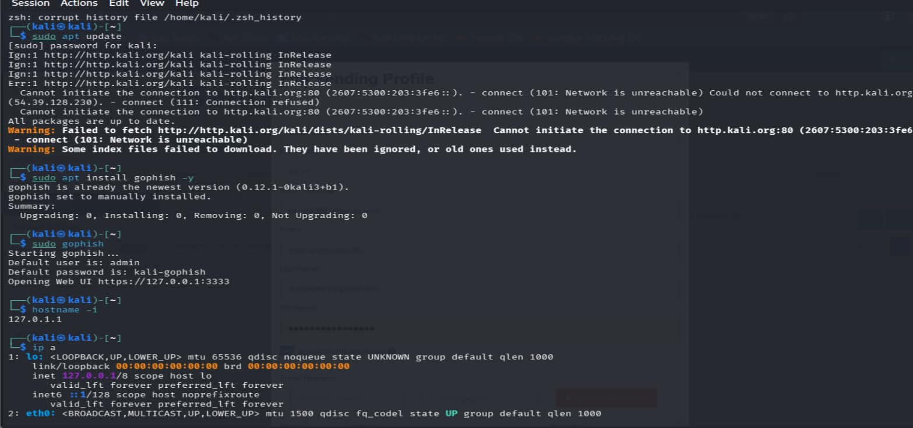
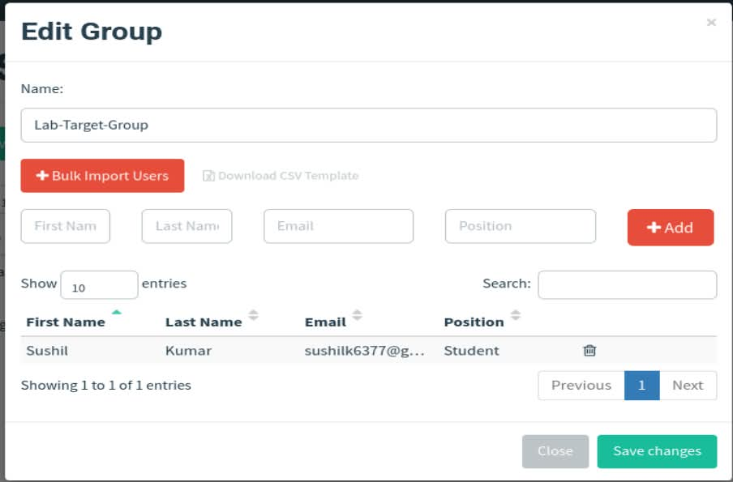
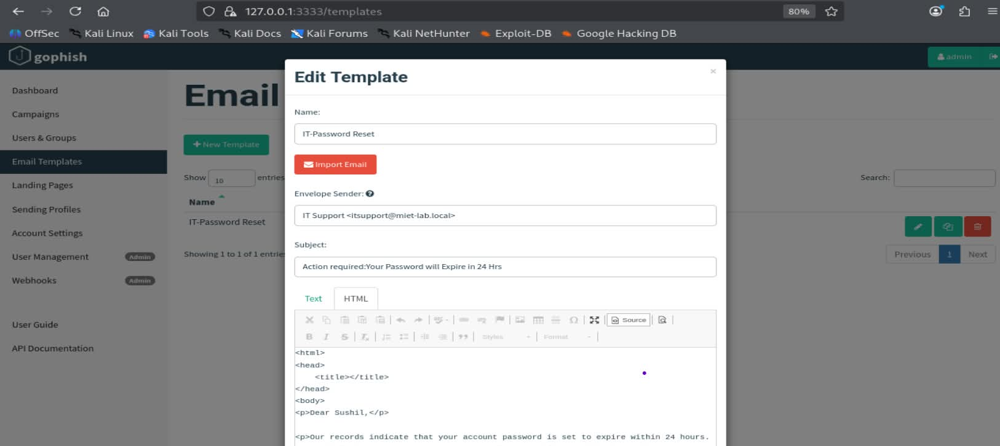
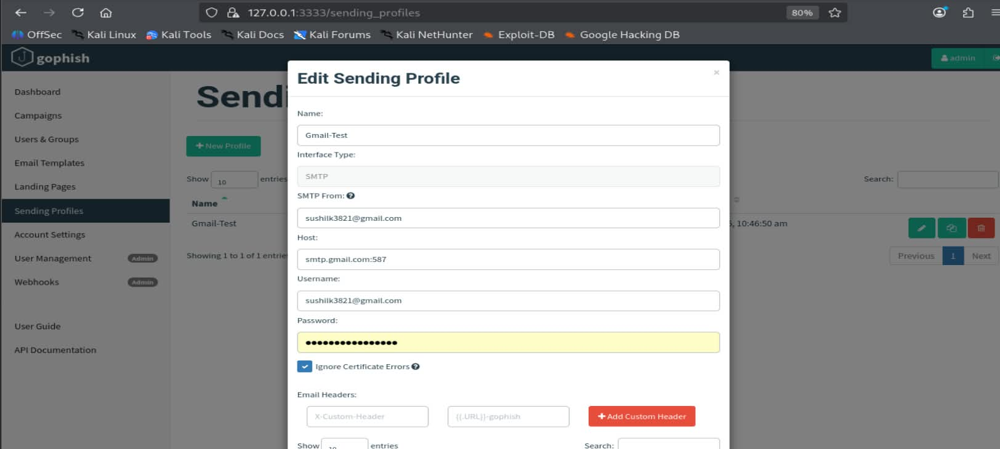
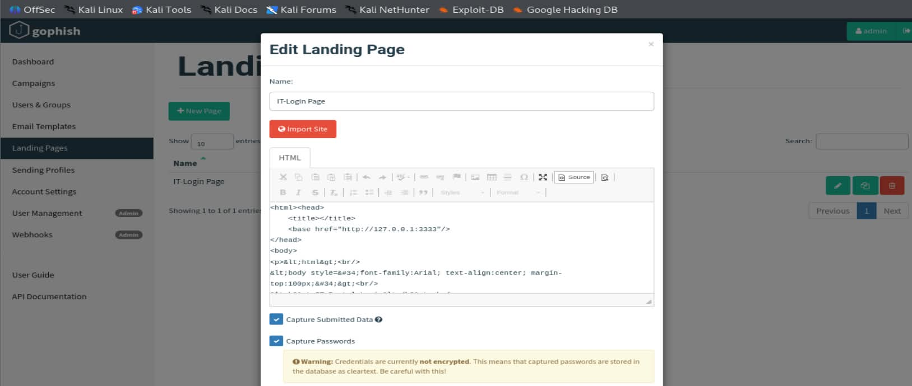
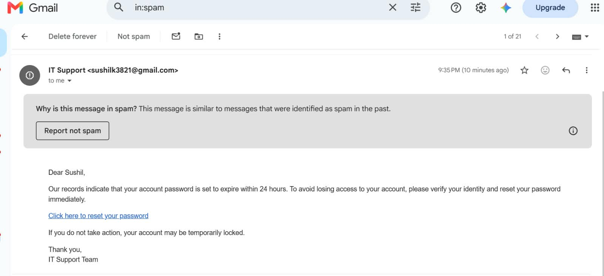
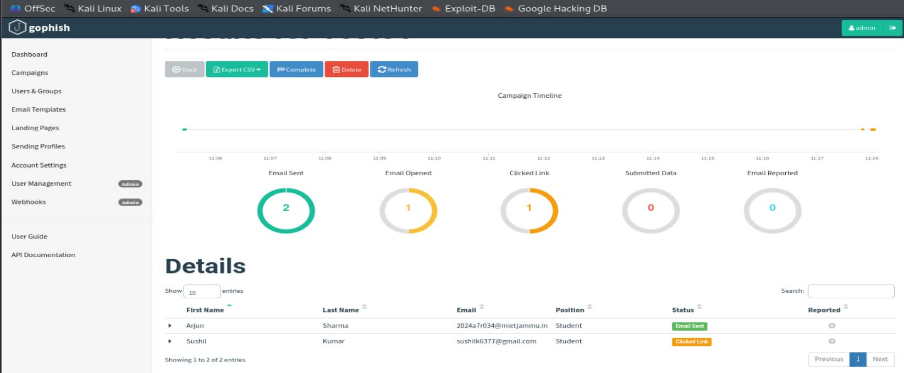

# Experiment 10: Phishing Simulation Using Gophish

## 1. Objective

To understand how phishing campaigns are designed and executed by creating and running a simulated phishing attack using **Gophish** in a controlled laboratory environment.

## 2. Procedure

### Step 1: Start Gophish in the Lab

Update the Kali Linux package lists, install Gophish, and launch the application. The Gophish web interface becomes available locally for configuring the simulation.

# Commands:

```bash
sudo apt update
sudo apt install gophish -y
sudo gophish
```



### Step 2: Prepare a Test Recipient Group

Create a recipient group in Gophish and add a single test recipient using a mailbox controlled by the person conducting the exercise or a participant who has agreed to the simulation.



### Step 3: Review the Awareness Email Template

Create and review a mock IT-themed email template containing a password expiration notification. The template is used as part of the controlled phishing awareness simulation.



### Step 4: Review the Sending Profile

Configure and review the SMTP sending profile required for email delivery. Keep the sending profile restricted to the authorized test mailbox and avoid exposing SMTP passwords or other account credentials.



### Step 5: Review the Landing Page Settings

Configure and review the mock login landing page used in the simulation. Keep password capture disabled to ensure that actual credentials are not collected during the awareness exercise.



### Step 6: Check Email Delivery in the Test Mailbox

Check the controlled test mailbox to verify whether the simulated phishing email was received. The test email appeared in the spam folder, demonstrating its delivery to the mailbox.



### Step 7: Review the Campaign Summary

Open the Gophish campaign summary and examine the recorded campaign statistics. At the time of capturing the screenshot, the campaign displayed the following results:

- Emails sent: 2
- Emails opened: 1
- Links clicked: 1
- Data submissions: 0
- Reports: 0



## 3. Result

The experiment demonstrated a phishing awareness simulation using **Gophish** with a controlled test recipient and a mock IT-themed email. The campaign recorded 2 emails sent, 1 opened, 1 link clicked, 0 data submissions, and 0 reports. The test email appeared in the spam folder. The exercise demonstrated the configuration and monitoring of a controlled phishing campaign without collecting actual credentials.
