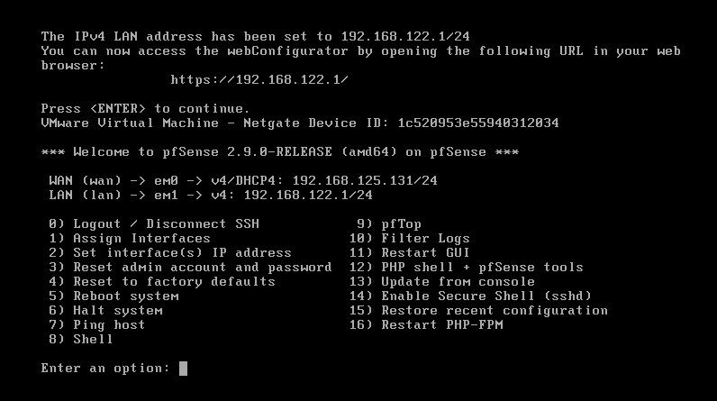
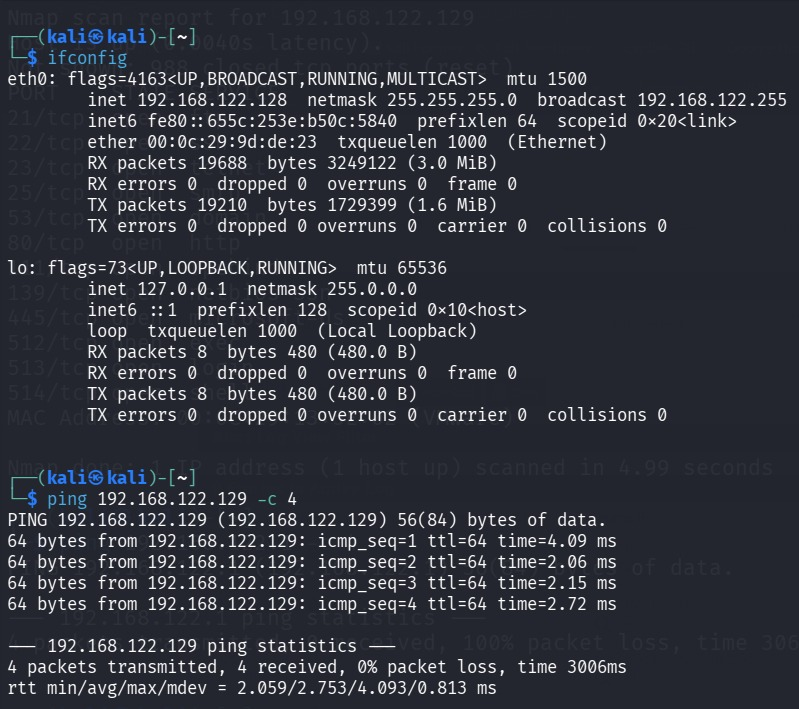
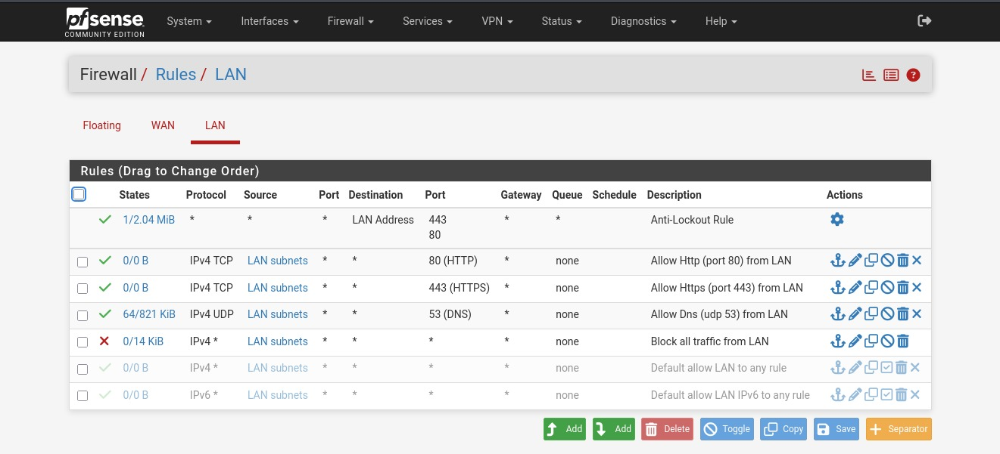
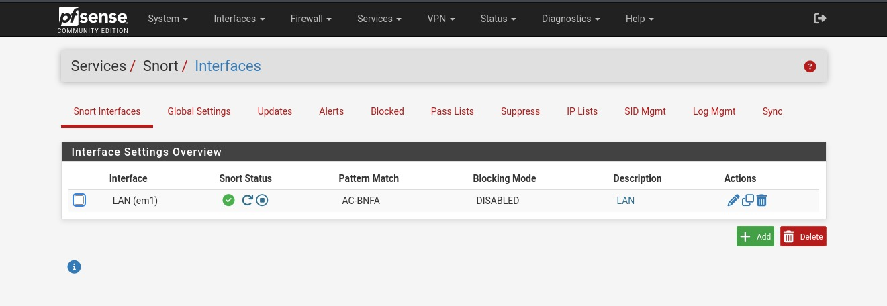
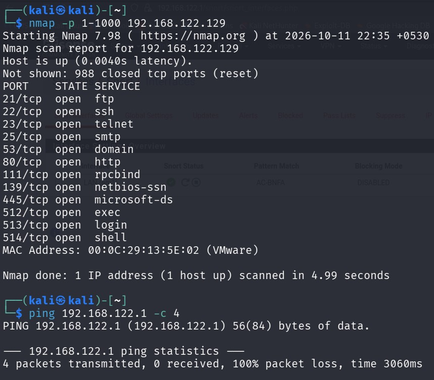
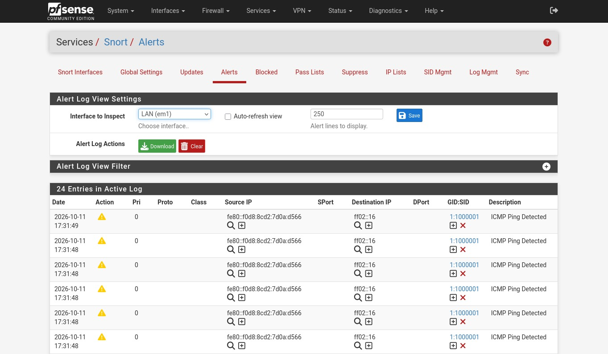

# Experiment 4: Firewall and IDS Setup

## Objective

To configure firewall rules using pfSense and enable intrusion detection using Snort to monitor network traffic and identify suspicious activities.

## Procedure

### Step 1: Configure the pfSense Network

Start the pfSense virtual machine and verify the WAN and LAN interface IP addresses. Confirm that the LAN interface is configured and accessible from the lab network.

**Screenshot:**



### Step 2: Verify Network Connectivity and Identify the Target

Use `ifconfig` on Kali Linux to identify its network interface and IP address. Ping the target machine and perform an Nmap scan to check connectivity and identify open ports and services.

**Commands Used:**

```bash
ifconfig
ping <Target-IP> -c 4
nmap <Target-IP>
```

**Screenshot:**



### Step 3: Configure Firewall Rules in pfSense

Log in to the pfSense web interface and navigate to **Firewall → Rules → LAN**. Configure firewall rules to allow required traffic, such as HTTP, HTTPS, and DNS, and block other traffic according to the lab requirements.

**Screenshot:**



### Step 4: Enable Snort on the LAN Interface

Open **Services → Snort → Interfaces** in pfSense. Configure Snort on the LAN interface and verify that its status indicates that the service is running.

**Screenshot:**



### Step 5: Generate Network Traffic and Check Detection

Generate network traffic from Kali Linux by pinging the target machine. Perform the relevant connectivity tests and observe the traffic monitored by the configured security tools.

**Commands Used:**

```bash
nmap -p 1-1000 <Target-IP>
ping <Target-IP>
```

**Screenshot:**



### Step 6: Examine Snort Alerts

Navigate to **Services → Snort → Alerts** in pfSense. Review the alert log to identify recorded events, including ICMP ping detection alerts generated during the test.

**Screenshot:**



## Result

The experiment demonstrated firewall rule configuration using pfSense and network traffic monitoring using Snort, with ICMP ping detection alerts observed in the alert log.
